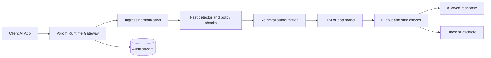

# Architecture

## v1 goal

Build a provenance-aware runtime gateway for prompt injection and data exfiltration prevention.

The v1 system is intentionally narrower than a full agent execution kernel. It protects AI chat, RAG, and simple tool-mediated workflows by enforcing deterministic controls around input, retrieval, output, and outbound sinks.

## Control flow

## Trust zones

| Zone | Examples | Default label | Rule |
|---|---|---|---|
| Trusted developer config | System policy, rule bundles, approved sink list | trusted | Can define authority |
| Authenticated user request | User intent, session metadata | user | Can request actions, cannot override system policy |
| Retrieved internal policy | Approved company KB or policy docs | internal | Can ground answers if tenant and role allow it |
| Borrower/customer upload | PDFs, images, OCR, forms, pasted docs | untrusted | Cannot issue instructions |
| External web content | URLs, pages, snippets | untrusted | Cannot issue instructions or define destinations |
| Model output | Generated response | generated | Must be checked before rendering or sending |

## Enforcement points

1. Normalize and sanitize untrusted content.
2. Run baseline injection and jailbreak detection.
3. Enforce tenant, role, sensitivity, and case scope before retrieval.
4. Attach provenance labels to every retrieved chunk.
5. Require grounded citations for financial and policy claims.
6. Block unsupported commitments.
7. Enforce sink policies before URLs, webhooks, email, exports, tool calls, or memory writes.
8. Write an immutable audit event.

## v2 direction

The v2 architecture should add a proof lane for high-risk actions:

- Abstract intent compiler
- Read/act split
- Information-flow control labels
- Differential replay or masked re-execution
- Tool manifest signing and MCP hardening
